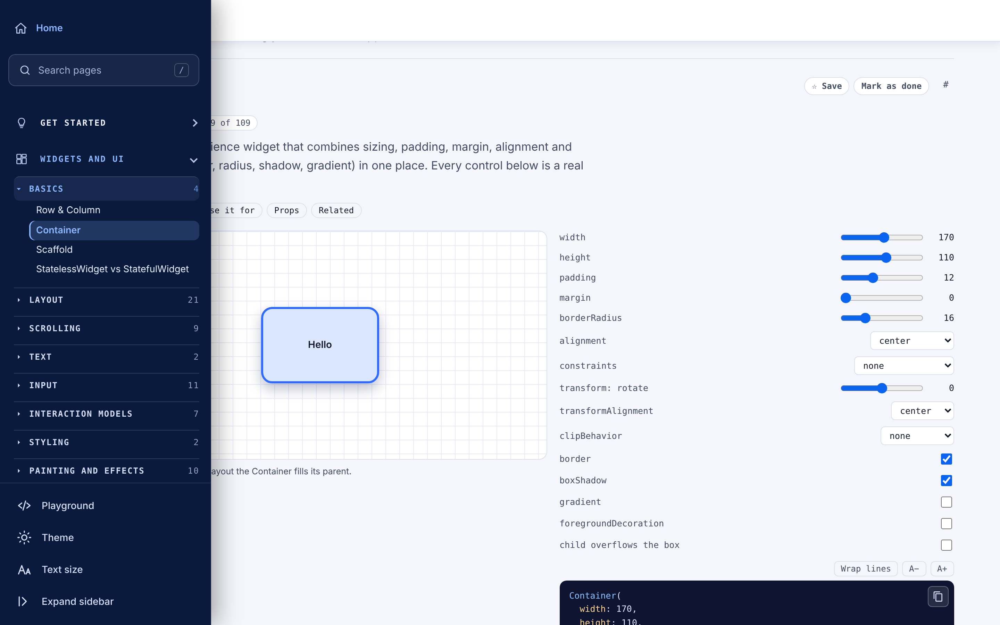

# Flutter Atlas

**An interactive, production-grade reference for Flutter — 176 pages of widgets, Dart concepts and app-building topics, each with a live editable demo, a grouped property reference, and matching Flutter code.**

**🔗 Live site: [mtaufiqh.github.io/flutter-widget-atlas](https://mtaufiqh.github.io/flutter-widget-atlas/)**



## What this is

Flutter Atlas isn't a list of widget names — it's a working lab. Every page lets you change a widget's real properties with sliders, dropdowns and toggles, watch the preview update immediately, and read the exact Flutter code that produces it. Property tables are grouped by how often you'd actually reach for each one (Everyday, topical groups, Rarely needed) and verified against [api.flutter.dev](https://api.flutter.dev), so the reference doubles as something you can build a production app from, not just a toy demo.

## Features

- **176 pages** spanning Flutter widgets, Dart language fundamentals, Android→Flutter translation, state & architecture, navigation, networking, Firebase, testing, performance, release and common runtime errors
- **Live, editable demos** — every control maps to a real widget property; nothing is simulated
- **Code that matches the demo** — the snippet updates as you change controls, and is copyable with one click
- **Grouped property reference** for every widget, cross-checked against the official Flutter API docs
- **Guided learning path** with step-by-step progress tracking (saved locally in your browser)
- **Playground** — write and run real Flutter/Dart code in-browser via an embedded DartPad
- **Search**, light/dark theme, adjustable text size, and a fully responsive layout down to mobile
- **Works offline** as an installable PWA (service worker + web manifest)
- **SEO-friendly** — every page also exists as a standalone, crawlable static page under [`/pages`](./pages), generated from the same content

## Content coverage

| Section | Pages |
|---|---|
| Layout | 21 |
| Dart language | 13 |
| Input | 11 |
| Painting and effects | 10 |
| Scrolling | 9 |
| Theming and resources | 9 |
| State and architecture | 8 |
| Material | 8 |
| Networking and data | 8 |
| Flavors and release | 7 |
| Common errors | 7 |
| Animation and motion | 7 |
| Interaction models | 7 |
| Testing and quality | 5 |
| Navigation and routing | 5 |
| App structure and auth | 5 |
| Coming from Android | 4 |
| Basics | 4 |
| Performance | 4 |
| Responsive and adaptive | 3 |
| Background and native code | 3 |
| Firebase | 3 |
| Text, Styling, Assets/images/icons, Async, Localization, Permissions/platform | 2 each |
| Accessibility, Playground, Worked example | 1 each |

## Tech stack

Flutter Atlas is a single self-contained web app — no framework, no build step, no dependencies. Just HTML, CSS and vanilla JavaScript, assembled into one file and deployed as a static site on GitHub Pages.

## Project structure

```
index.html            the entire app — one file, served as-is
pages/                 176 static, crawlable pages (one per topic), plus an index
sitemap.xml            search-engine sitemap covering the site and all pages/
robots.txt             crawler rules
manifest.webmanifest   PWA metadata
sw.js                  service worker (offline support)
icon.svg               app/favicon icon
```

## Running it locally

No install, no build. Clone the repo and open `index.html` in a browser, or serve the folder with any static file server:

```bash
git clone https://github.com/MtaufiqH/flutter-widget-atlas.git
cd flutter-widget-atlas
python3 -m http.server 8000
# open http://localhost:8000
```

## License

© 2026 M Taufiq Hidayat. All rights reserved.
